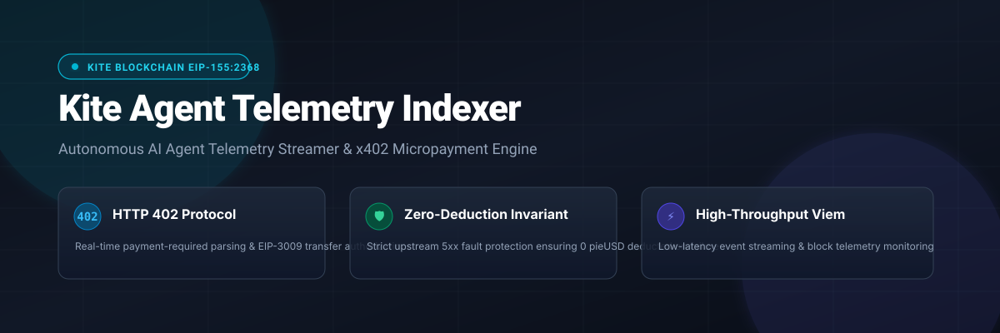
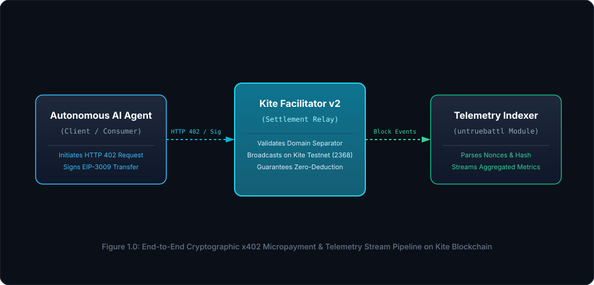

# Kite Agent Telemetry Indexer 🛸

<p align="center">
  
</p>

<p align="center">
  <a href="https://gokite.ai"></a>
  <a href="https://github.com/wevm/viem"></a>
  <a href="https://www.typescriptlang.org/"></a>
  <a href="LICENSE"></a>
</p>

---

## 📌 Executive Summary

**Kite Agent Telemetry Indexer** is an event-driven telemetry stream engine and diagnostic client designed for the **Kite AI Agentic Economy** (EIP-155: `2368` Testnet / `2366` Mainnet). 

It bridges raw autonomous agent execution traces with HTTP 402 micro-billing verification, EIP-3009 `TransferWithAuthorization` cryptographic authorization validation, and Facilitator v2 settlement telemetry.

---

## 🏗 System Architecture & Data Flow

<p align="center">
  
</p>

### Key Architectural Invariants

1. **Zero-Deduction Safety Invariant**:
   * The indexer asserts that for any faulted agent invocation (upstream HTTP 502/504), the settled `pieUSD` debit amount is strictly **`0`**.
2. **Reentrancy & Nonce Replay Prevention**:
   * Every event stream tracks single-use 32-byte cryptographic nonces to ensure complete idempotency across multi-agent execution clusters.
3. **EIP-712 / EIP-3009 Typed Data Verification**:
   * Automatically derives the official Domain Separator for `pieUSD` (`0x38129cf4CE5E183eFF248F42A7D345Bb1B47621A`) on Kite Testnet (Chain ID: `2368`).

---

## 🌟 Core Features

- 🛰 **Low-Latency Block & Relay Probing**: Intercepts on-chain settlement blocks via Viem RPC and Facilitator v2 health endpoints.
- 📊 **Real-Time Telemetry Analytics**: Aggregates average response latency (ms), active agent quorum, and accumulated `pieUSD` micro-settlement volume.
- 🛡 **Formal Invariant Verifier**: Built-in test assertions guaranteeing that edge-case failures do not deduct user or agent assets.
- 💻 **Interactive CLI Diagnostic Utility**: Includes an executable command-line interface (`npx tsx src/cli.ts`) for real-time network health interrogation.

---

## 🚀 Quick Start

### 1. Prerequisites
- Node.js >= 20
- npm >= 10

### 2. Installation

```bash
git clone https://github.com/untruebattl/kite-agent-telemetry-indexer.git
cd kite-agent-telemetry-indexer
npm install
```

### 3. Build & Run Telemetry Engine

```bash
# Build TypeScript artifacts
npm run build

# Start live event ingestion stream
npm start
```

### 4. Interactive CLI Diagnostic Probe

```bash
npx tsx src/cli.ts
```

### 5. Run Automated Test Suite

```bash
npm test
```

---

## ⛓️ Network Specifications

| Parameter | Kite Testnet | Kite Mainnet |
| :--- | :--- | :--- |
| **CAIP-2 ID** | `eip155:2368` | `eip155:2366` |
| **Chain ID** | `2368` | `2366` |
| **Settlement Token** | `pieUSD` (18 decimals) | `USDC.e` (6 decimals) |
| **Asset Contract** | `0x38129cf4CE5E183eFF248F42A7D345Bb1B47621A` | `0x7aB6f3ed87C42eF0aDb67Ed95090f8bF5240149e` |
| **Facilitator RPC** | `https://facilitator.pieverse.io/v2` | `https://facilitator.pieverse.io/v2` |
| **Explorer** | [testnet.kitescan.ai](https://testnet.kitescan.ai) | [kitescan.ai](https://kitescan.ai) |

---

## 📂 Project Directory Structure

```text
kite-agent-telemetry-indexer/
├── assets/
│   ├── banner.svg            # Vector UI header illustration
│   └── architecture.svg      # End-to-end data flow flowchart
├── docs/
│   ├── ARCHITECTURE.md       # Technical specs & sequence diagrams
│   └── ROADMAP.md            # Quarterly engineering milestones
├── src/
│   ├── chains.ts             # Viem Kite chain configurations (2368 / 2366)
│   ├── cli.ts                # Command-line diagnostic probe executable
│   ├── eip3009.ts            # EIP-712 domain separator & typed data schemas
│   ├── facilitator.ts        # Facilitator v2 health prober & safety invariant engine
│   ├── index.ts              # Event streamer main entrypoint
│   ├── indexer.ts            # Core telemetry aggregation state manager
│   └── types.ts              # Strict TypeScript definitions
├── test/
│   ├── facilitator.test.ts   # Integration tests for Facilitator & zero-deduction
│   └── indexer.test.ts       # Unit tests for event ingestion & calculations
├── package.json
├── tsconfig.json
└── README.md
```

---

## 📜 License

Distributed under the **Apache-2.0** License.
